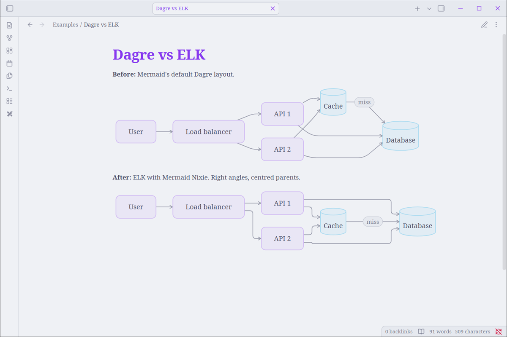
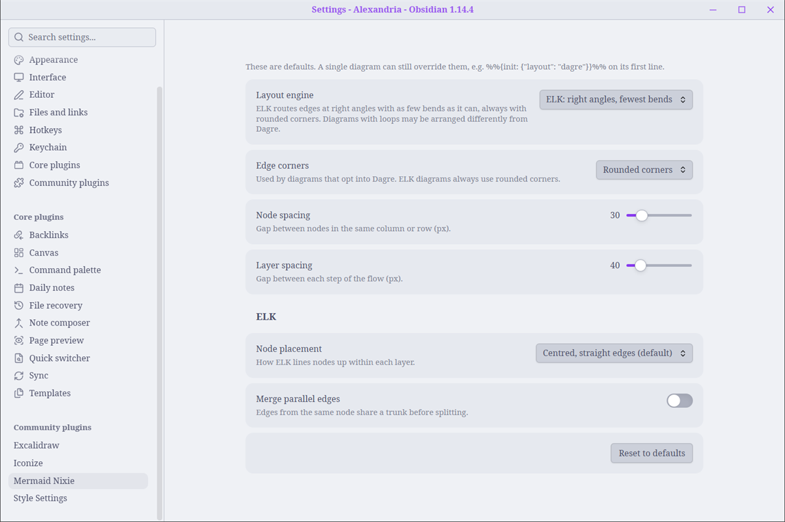
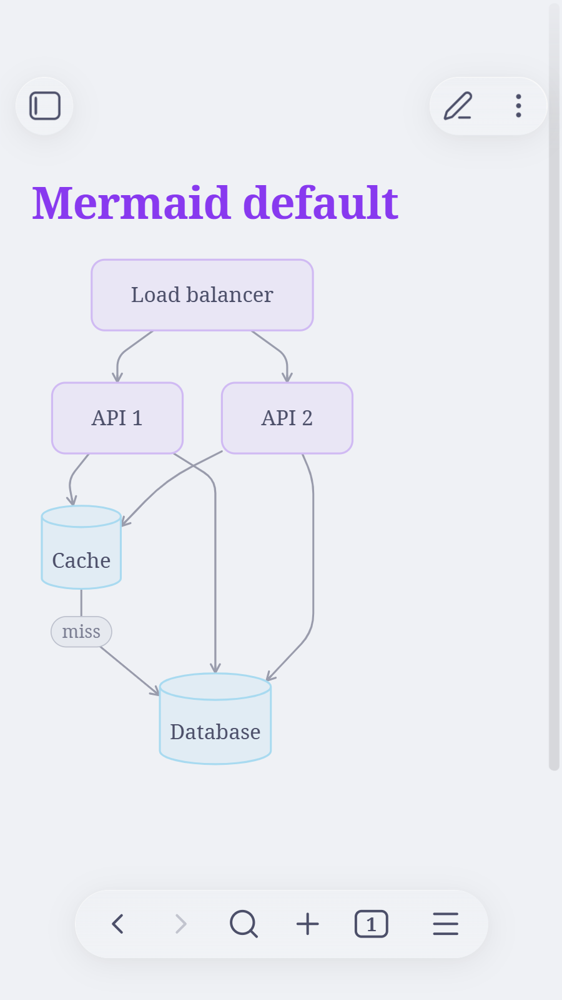
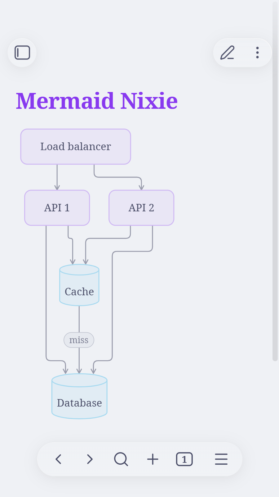

# Mermaid Nixie

An Obsidian plugin that sets how Mermaid diagrams are laid out across your vault: the ELK layout engine with right-angle edges, plus spacing settings.



## Features

- **Layout engine:** ELK (right angles, fewest bends) or Dagre (Mermaid's default).
- **Edge corners:** rounded, sharp, step, or one of the smooth curves (for diagrams that use Dagre).
- **Node spacing** and **layer spacing** sliders, which also apply to ELK (Mermaid's own ELK integration ignores them).
- **ELK node placement:** centred by default (`NETWORK_SIMPLEX`), so parents sit over their children.
- **Merge parallel edges** toggle.
- A command to re-render diagrams in open notes.



These settings are only defaults. A single diagram can still override them on its first line:

```
%%{init: {"layout": "dagre"}}%%
```

It works on mobile too. Before and after:

<p>
  
  
</p>

## Install

Download `main.js` and `manifest.json` from the [latest release](../../releases/latest) into `<vault>/.obsidian/plugins/mermaid-nixie/`, then enable **Mermaid Nixie** under *Settings → Community plugins*.

ELK is bundled into `main.js` (~5 MB) and only runs the first time a diagram needs it.

## Build

```sh
npm install
npm run build
```

The build writes `dist/main.js`. Pushing a version tag (e.g. `1.0.2`) builds the plugin on GitHub Actions, attests `main.js` and publishes the release.

## License

MIT. `main.js` bundles [@mermaid-js/layout-elk](https://github.com/mermaid-js/mermaid) (MIT) and [elkjs](https://github.com/kieler/elkjs) (EPL-2.0).
